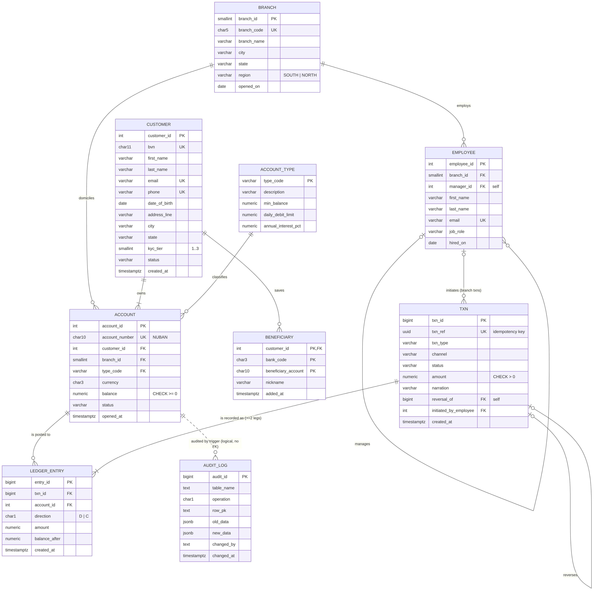

# Portfolio 1: Database Design and Modelling

**Case study:** KoboTrust Digital Bank, a simulated Nigerian digital bank (see the root README for the full case-study statement).
**DBMS:** PostgreSQL 16

## 1. What this portfolio contains

| File | Purpose |
|---|---|
| `sql/01_schema.sql` | DDL: 9 tables, domains, PK/FK/UNIQUE/CHECK constraints, deferred double-entry trigger, audit trigger |
| `sql/02_seed_data.sql` | Reproducible synthetic data (`setseed`), about 1 million ledger rows |
| `sql/03_business_logic.sql` | `transfer_funds()`, `reverse_transaction()`, the `v_customer_accounts` view |
| `sql/04_constraint_tests.sql` | 11 tests, each expected to be rejected by a constraint (plus one valid transfer) |
| `diagrams/erd.mmd` → `erd.png` / `erd.svg` | ER diagram (Mermaid source and rendered images) |
| `evidence/` | Captured output: seed run, integrity checks, constraint tests, `\d` descriptions |

### How to run
```bash
createdb kobotrust
psql -d kobotrust -f sql/01_schema.sql
psql -d kobotrust -f sql/02_seed_data.sql        # about 1 minute
psql -d kobotrust -f sql/03_business_logic.sql
psql -d kobotrust -f sql/04_constraint_tests.sql
```

## 2. Requirements → entities

| Business requirement | Modelled as |
|---|---|
| Customers are identified nationally by BVN and contacted by phone/email | `customer` (BVN, email and phone are each `UNIQUE`, so each one is a candidate key) |
| A customer can hold several accounts (savings, current, kiddies, domiciliary) | `customer 1─N account`; product rules live in `account_type` |
| Each account belongs to one branch; branches have staff with a manager hierarchy | `branch 1─N account`, `branch 1─N employee`, `employee.manager_id` (self-referencing FK) |
| Every movement of money must be traceable and must balance | `txn` (business event) `1─N ledger_entry` (double-entry legs) |
| Mistaken transfers are corrected by a reversal, never by editing history | `txn.reversal_of` (self-referencing FK) plus `CHECK chk_reversal` |
| Customers save payees | `beneficiary` (composite PK: customer, bank code, account) |
| Regulators require an audit trail of balance changes | `audit_log` filled by a trigger, before/after images stored as `JSONB` |

## 3. ER diagram



Cardinalities: a customer **must** have one or more accounts (`||--|{`). A txn has **at least two** ledger legs. An employee initiates **zero or more** txns, because customer self-service txns have no employee.

## 4. Keys and constraints

| Type | Examples | Why |
|---|---|---|
| Surrogate PK | `customer_id`, `account_id`, `txn_id` (`GENERATED ALWAYS AS IDENTITY`) | Stable and compact join keys. Natural keys such as BVN or phone can change or be corrected. |
| Candidate/alternate keys | `customer.bvn`, `customer.email`, `customer.phone`, `account.account_number`, `txn.txn_ref` | Enforce real-world uniqueness |
| Composite PK | `beneficiary(customer_id, bank_code, beneficiary_account)` | A payee is only unique per customer |
| FK + referential action | `account.customer_id … ON DELETE RESTRICT`; `beneficiary … ON DELETE CASCADE` | You cannot delete a customer who still holds money. Saved payees go when the customer goes. |
| Domains | `nuban` (10 digits), `bvn_t` (11 digits), `positive_amount` | Rule written once, reused across tables |
| CHECK | `balance >= 0`, `kyc_tier 1..3`, adult customers, Nigerian phone format, enum-like status lists | Business rules enforced by the DBMS, not only by the app |
| Deferred constraint trigger | `ledger_balanced`: Σdebits = Σcredits per txn, checked at COMMIT | A multi-row rule that a CHECK cannot express. It is deferred so both legs can be inserted first. |
| Money type | `NUMERIC(18,2)` | Exact decimal. `FLOAT` would introduce rounding errors in money. |

Evidence: `evidence/constraint_tests_output.txt` shows all 10 invalid operations rejected (T1–T10) and the valid transfer being audited (T11).

## 5. Normalisation

### Starting point: the unnormalised "statement sheet" (UNF)
Before the database existed, a branch kept transactions in one spreadsheet:

| txn_ref | date | from_acct | from_name | from_bvn | from_phone | from_branch | from_branch_city | acct_type | type_daily_limit | to_acct | to_name | amount | channel | payees |
|---|---|---|---|---|---|---|---|---|---|---|---|---|---|---|
| T001 | 2026-03-01 | 1000000027 | Chiamaka Udeh | 22000000037 | +23480… | LAG03 | Lagos | SAVINGS | 1,000,000 | 1000000040 | Hadiza Adebayo | 2,500 | MOBILE | "1000000040, 1000000053" |

Problems:
- **Repeating group:** `payees` holds a list.
- **Update anomaly:** a customer's phone is repeated on every row they appear in.
- **Insertion anomaly:** a new customer cannot be recorded until they make a transaction.
- **Deletion anomaly:** deleting a customer's only transaction loses the customer.

### 1NF: atomic values, no repeating groups
- Split `payees` into a separate relation `BENEFICIARY(customer, bank_code, beneficiary_account, nickname)`.
- Split the transfer into atomic **legs**, so that each row records one account being debited or credited.

### 2NF: no partial dependency on part of a composite key
In the 1NF leg relation `LEG(txn_ref, account_number, direction, amount, date, channel, holder_name, holder_bvn, …)`, the key is `(txn_ref, account_number)`. However:
- `txn_ref → date, channel, txn_type, status` depends on only **part** of the key.
- `account_number → holder_name, holder_bvn, branch, type` depends on only the **other part**.

Decompose into `TXN(txn_ref, date, channel, type, status, amount)`, `ACCOUNT(account_number, customer, branch, type, balance)` and `LEDGER_ENTRY(txn, account, direction, amount, balance_after)`.

### 3NF: no transitive dependency
- `account_number → customer_bvn → customer_name, phone, dob`: customer data depends on the account only **through** the customer. Moved to `CUSTOMER`.
- `account_number → type_code → min_balance, daily_debit_limit, interest`: moved to the `ACCOUNT_TYPE` lookup table.
- `account_number → branch_code → branch_city, state, region`: moved to `BRANCH`.

### BCNF check
For every non-trivial FD X → Y in each final table, X is a superkey. For example:
- `CUSTOMER`: `customer_id`, `bvn`, `email` and `phone` are **each** candidate keys, and every other attribute depends on each of them, so it is in BCNF.
- `BENEFICIARY`: the only FD is `(customer_id, bank_code, beneficiary_account) → nickname, added_at`, so it is in BCNF.

### Deliberate, controlled denormalisation
| Attribute | Why it is redundant | Why it is kept | How consistency is guaranteed |
|---|---|---|---|
| `account.balance` | Derivable as Σcredits − Σdebits over `ledger_entry` | Balance checks happen on every transfer; summing up to 1M rows each time is too slow | Updated only inside `transfer_funds()`/`reverse_transaction()` in the **same transaction** as the ledger insert. The seed script re-verifies that it equals the last `balance_after` (0 mismatches). |
| `ledger_entry.balance_after` | Derivable through a running SUM | Statement generation without a window over the full history | Same as above |

This is a conscious trade-off between normal-form purity and OLTP performance, and it is common practice in core-banking systems.

## 6. Data set produced (from `evidence/seed_run_output.txt`)

| Table | Rows |
|---|---|
| branch | 12 |
| employee | 120 |
| customer | 20,001 (incl. the bank's own treasury record) |
| account | 30,001 (incl. 1 internal GL settlement account) |
| txn | 519,197 |
| ledger_entry | 1,011,370 |

The generator produces random debits, so some would overdraw an account. These are **declined** (`status = FAILED`, narration "insufficient funds"), the way a real core-banking system would decline them. The integrity checks then confirm 0 unbalanced txns, 0 negative running balances and 0 balance mismatches.
