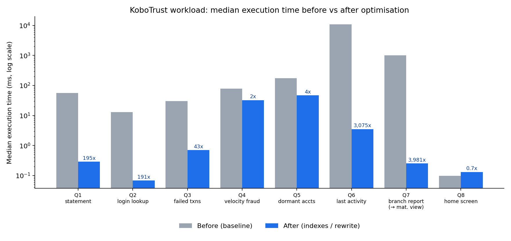

# Portfolio 2: Query Processing and Optimisation

**Case study:** KoboTrust Digital Bank, 1.01M ledger rows, 519k transactions, 30k accounts (data from Portfolio 1).
**DBMS:** PostgreSQL 16, cost-based optimiser, measured with `EXPLAIN (ANALYZE, BUFFERS)`.

## Method
1. Define a realistic **workload** of 8 queries that the bank actually runs (`sql/01_workload_queries.sql`).
2. **Baseline:** only the PK/UNIQUE/FK indexes from P1 exist (`sql/00_reset_baseline.sql`).
3. Read each baseline plan, find the expensive node, and design a **targeted** fix (`sql/02_optimisations.sql`), plus logical rewrites (`sql/03_rewritten_queries.sql`).
4. `run_benchmark.py` runs every query **5 times per phase after a warm-up** and records the **median server-side `Execution Time`** (no network noise) and the buffers touched. It saves every plan in `evidence/plans/{before,after}/` and every result in `evidence/query_results/`.

```bash
python3 run_benchmark.py --runs 5      # about 3 minutes; writes evidence/benchmark_results.csv and benchmark_chart.png
```

## Results



| Query (business purpose) | Baseline plan → problem | Optimisation | Before | After | Buffers before → after |
|---|---|---|---|---|---|
| **Q1** account statement (1 account, 6 months) | Parallel **Seq Scan** of 1M ledger rows, removing 337k per worker, then a Sort | Composite B-tree `(account_id, created_at, entry_id)`: equality column first, then range/sort, so the index also returns rows **already ordered** | 56.6 ms | **0.29 ms** | 18,459 → 57 |
| **Q2** login by e-mail (case-insensitive) | `lower(email)` cannot use the UNIQUE index on `email`, so a Seq Scan | **Expression index** on `lower(email)` | 12.96 ms | **0.07 ms** | 392 → 3 |
| **Q3** failed txns in the last week | Seq Scan of 519k txns to find about 2% FAILED | **Partial index** `ON txn(created_at) WHERE status='FAILED'` (312 kB vs 11 MB for a full index) | 30.5 ms | **0.71 ms** | 7,992 → 208 |
| **Q4** velocity fraud rule (`lag()` window) | Seq Scan, then a Sort for the window | Partial debit index `(account_id, created_at) WHERE direction='D'` → **Index Only Scan** already in window order; **Heap Fetches: 0** | 79.1 ms | **32.6 ms** | 18,472 → 1,947 |
| **Q5** dormant accounts (NOT EXISTS) | Hash Anti Join over a Seq Scan of the ledger | Same partial index → Index Only Scan feeding a **Hash Right Anti Join** | 174.2 ms | **46.7 ms** | 19,006 → 2,566 |
| **Q6** last activity per account (correlated subquery) | Subquery runs **134 times**, each a full ledger scan, about 2.46 **million** buffers | Composite index lets `max(created_at)` become an **Index Only Scan Backward + LIMIT 1** per account | 10,837 ms | **3.52 ms** | 2,463,676 → 844 |
| **Q7** branch monthly report (2026) | Hash Join + **external merge sort spilling about 20 MB to disk** | Indexes cannot help (it reads about half the table, so the optimiser correctly keeps the Seq Scan). **Materialized view** `mv_branch_monthly`, refreshed nightly. | 1,011 ms | **0.25 ms** (MV) | 19,010 → 10 |
| **Q8** home-screen balances | Already an Index Scan on the FK index | **Covering index** `INCLUDE (account_number, type_code, balance)` → Index Only Scan (heap visits 4 → 3; time difference is measurement noise at this scale) | 0.098 ms | 0.131 ms | 4 → 3 |

All numbers are from `evidence/benchmark_results.csv`. Planning time stays below about 1 ms for every query.

## Analysis

**1. The biggest wins come from turning "scan everything" into "seek and read a few pages".** Q1, Q2, Q3 and Q6 dropped by about 40× to 3,000× because the optimiser could switch from a sequential scan to an index seek. The *buffers touched* column shows the real reason: I/O fell by 2–3 orders of magnitude.

**2. Column order in a composite index matters.** `(account_id, created_at)` serves equality on `account_id` *and* the range or order on `created_at`. The reverse order `(created_at, account_id)` could not seek directly to one account.

**3. Partial and expression indexes are small and precise.** The FAILED-only index is **312 kB** against an 11 MB primary key on the same table (`evidence/index_sizes.txt`). An index that matches the predicate exactly is both faster and cheaper to maintain on every INSERT.

**4. Indexes are not always the answer.** Q7 reads about half of the ledger, so a Seq Scan is cheaper than random index I/O, and the optimiser rightly ignored both the B-tree and the **BRIN** index. The fixes there are:
- **Precomputation** (materialized view: about 4,000×). The trade-off is staleness, which is acceptable for a monthly report.
- **Memory tuning**: raising `work_mem` from 4 MB to 64 MB turned the on-disk *external merge* (20.6 MB spilled) into an in-memory *quicksort* and cut execution time from 1,846 ms to 1,228 ms, **about 33% faster** (`sql/04_q7_work_mem_test.sql` → `evidence/q7_work_mem_test.txt`).

The BRIN index is only **32 kB** against about 39 MB for a B-tree on 1M rows. It would pay off for narrow time ranges on an append-only ledger.

**5. After indexing, the "naive" correlated subquery (Q6) was *faster* than the textbook JOIN rewrite (3.52 ms vs 4.96 ms).** With the composite index, each correlated `max()` becomes a single backward index probe. The rewrite has to aggregate every posting of the 134 accounts. The lesson is to measure rather than assume that a rewrite helps.

**6. Costs of the indexes.** Together they add about 57 MB on the ledger (`idx_ledger_acct_time` 39 MB + debits partial 15 MB + BRIN), and every transfer now updates more index entries. This is acceptable for a read-heavy banking app, but the trade-off appears in P3's write throughput. Unused indexes should be found with `pg_stat_user_indexes.idx_scan = 0` and dropped.

**7. Cardinality estimates matter.** In Q7 the planner estimated 588,248 groups when there were actually 121. A large estimation error like this can lead to a poor choice of join or aggregation strategy. Extended statistics (`CREATE STATISTICS … (dependencies)`) are the next step.

## Files
`sql/00_reset_baseline.sql` · `sql/01_workload_queries.sql` · `sql/02_optimisations.sql` · `sql/03_rewritten_queries.sql` · `run_benchmark.py` · `evidence/plans/before/*.txt`, `evidence/plans/after/*.txt` (full EXPLAIN ANALYZE output) · `evidence/query_results/*.txt` · `evidence/benchmark_results.csv` · `evidence/benchmark_chart.png` · `evidence/index_sizes.txt` · `sql/04_q7_work_mem_test.sql` → `evidence/q7_work_mem_test.txt`

Q4's results list **11 accounts**. They are the planted velocity-burst pattern from the seed data (12 planted; the 12th account's five transfers were all declined for insufficient funds, so they never reached the ledger).
