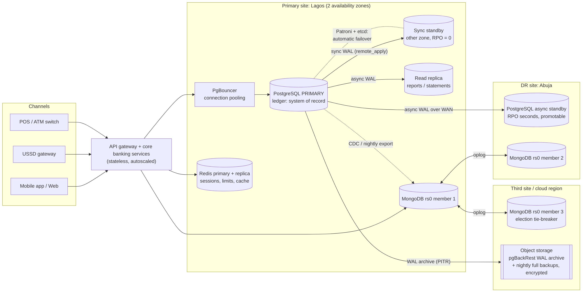

# Portfolio 5: Distributed and Cloud Database Exercise

**Case study:** KoboTrust Digital Bank. A bank needs to keep running when a server or a data centre fails (**availability**), must never lose or duplicate money (**consistency**), and must grow beyond one machine (**scalability**). This portfolio implements and measures each of these with real multi-node setups.

| Part | What was built | Executed? | Evidence |
|---|---|---|---|
| A. Replication and failover | PostgreSQL 16 primary (5432) + hot standby (5433) via streaming replication | **Yes** | `evidence/replication_demo_output.txt` |
| B. Sharding | 2 shard nodes (SOUTH 5434, NORTH 5435) + coordinator using `postgres_fdw` and partitioned foreign tables | **Yes** | `evidence/sharding_queries_output.txt` |
| C. Distributed transaction | Cross-shard transfer with **two-phase commit**, including failure cases | **Yes** | `evidence/two_phase_commit_output.txt` |
| D. MongoDB replica set and sharding | `docker-compose.yml`, init, failover test, sharding plan | Scripts (run locally) | `mongodb-cluster/` |
| E. Cloud deployment design | Target architecture, RPO/RTO, managed-service options | Design | `cloud/architecture.png` |

## A. Streaming replication, consistency and failover (`replication/replication_demo.sh`)

| Step | Result (from the evidence file) | Concept |
|---|---|---|
| R1 | `pg_basebackup -R` cloned the database in about 2 s and the standby started in recovery mode | Physical (WAL-based) replication |
| R2 | `pg_stat_replication`: `standby_lagos2`, `streaming`, `async`, replay lag below 1 ms while idle. The standby served `count(*) = 30,104 accounts`, `sum(balance) = 200,000,000,000.00`. That equals exactly the GL float seeded in P1, so **money is conserved** across the whole bank. | Read scaling |
| R3 | `ERROR: cannot execute UPDATE in a read-only transaction` | Standbys are read-only |
| R4 | After a 1.5M-row commit on the primary, the standby showed **0 rows at +79 ms, then all 1,500,000 at +275 ms** | **Eventual consistency** (stale reads). The transaction is replayed atomically, so the standby never shows a partial result. |
| R5 | With `synchronous_standby_names = 'FIRST 1 (standby_lagos2)'` and `remote_apply`, the row was visible on the standby **as soon as COMMIT returned**. Commit latency rose from **0.15 ms to 0.32 ms** (about 2.1×). | **Strong consistency** at a latency cost |
| R6 | Standby down: the writer waited on `wait_event = SyncRep` (3 s and counting). Cancelling gave `WARNING: … committed locally, but might not have been replicated` | **CAP:** under a partition, the synchronous setup chooses **C over A** |
| R7 | Primary killed (`-m immediate`); standby promoted in **0.15 s**; the last txn_id before the crash (579872) was present on the new primary, and new writes succeeded (579873) | Failover, **RPO = 0** for committed data that had replicated |
| R8 | The old primary must not come back as a second writable node (**split brain**). In production it is rebuilt with `pg_rewind`; Patroni with etcd automates the leader election. | |

## B. Sharding with postgres_fdw (`sharding/`)

Shard key: **`region`** of the account's home branch (SOUTH = Lagos, Ibadan, PH, Enugu, Benin; NORTH = Abuja, Kano, Kaduna, Jos). The key is chosen for **data locality** (customers mostly transact within their region and are served by the nearest data centre) and for **regulatory zoning**.

| # | Query | Plan behaviour (from `EXPLAIN VERBOSE`) |
|---|---|---|
| SH1 | Distribution | SOUTH 18,437 accounts / 451k postings vs NORTH 11,666 / 219k. The data is **skewed about 1.6–2 : 1**. SOUTH also absorbed all of P3's November stress-test traffic (60,591 credits from one Lagos branch), which shows a **hot shard**. |
| SH2 | Lookup *with* the shard key | **Partition pruning**: one `Foreign Scan on account_north`. Only one shard is contacted. |
| SH3 | Lookup *without* the shard key | **Scatter-gather**: `Append` over both shards |
| SH4a | `GROUP BY region` | **Aggregate pushed down**: each shard runs `SELECT region, count(*), sum(amount) … GROUP BY 1` |
| SH4b | `GROUP BY date_trunc('month', created_at)` | **Not pushed down**: `date_trunc(timestamptz)` is only STABLE (it depends on the TimeZone setting), so raw rows are shipped to the coordinator |
| SH5 | Same 700k-row aggregate, local vs sharded | **77 ms local vs 420 ms sharded**. With all nodes on one machine, distribution only adds network and serialisation cost. Sharding pays off only when data or write volume exceeds one server. |
| SH6 | Join inside one shard | Default fdw costing pulled the whole SOUTH ledger: **618 ms**. With `use_remote_estimate = true` the plan became a parameterised per-account lookup: **4.4 ms**, about **140× faster**. Distributed query optimisers need accurate remote statistics. |

**Hash vs list sharding:** list-by-region gives locality and zoning, but it is skewed. Hash on `account_number` would balance the load, but every regional report would become scatter-gather. A hybrid (region → several hash buckets per region) is what Citus or Atlas zone sharding provide.

## C. Cross-shard transfer with Two-Phase Commit (`sharding/03_two_phase_commit.sh`)

A transfer from a Lagos account (SOUTH shard) to an Abuja account (NORTH shard) spans two servers.

| Case | What happened | Lesson |
|---|---|---|
| A. Happy path | Both shards `PREPARE TRANSACTION '<uuid>'` (visible in `pg_prepared_xacts`), then `COMMIT PREPARED` on both. 840,752.04 → 835,752.04 and 1,264,095.52 → 1,269,095.52. | Atomic commit across nodes |
| B. A shard votes NO | SOUTH's debit violated `CHECK (balance >= 0)`, so it never prepared. The coordinator sent `ROLLBACK PREPARED` to NORTH, and **both balances were unchanged**. | All-or-nothing |
| C. Coordinator crash between phases | The prepared txn **survived and held its row lock**. A normal customer debit hit `lock timeout`. Recovery = the coordinator re-reads its decision log and finishes `COMMIT PREPARED`. | 2PC is **blocking**. This is why banks avoid synchronous cross-shard transactions on the hot path. |
| Invariant | SOUTH debit legs = NORTH credit legs (2 = 2, same refs and amounts) | Global consistency check |

Alternatives for production: the **Saga pattern** (local debit → event → local credit, with a compensating reversal on failure, using `reverse_transaction()` from P1), or a distributed SQL engine with consensus-based commits (CockroachDB, YugabyteDB, Spanner).

## D. MongoDB replica set and sharding (`mongodb-cluster/`)
```bash
docker compose up -d && ./init-replica-set.sh && ./failover-test.sh
mongosh "mongodb://localhost:27017/kobotrust?directConnection=true" ../portfolio-4-nosql/mongodb/04_transfer_transaction.js
```
- 3 members (`priority: 2` on the preferred Lagos node), `w: "majority"` vs `w: 1` write-concern latency, and `secondaryPreferred` reads.
- `failover-test.sh` stops the primary and polls `rs.status()` until a new primary is elected (normally within about 10–12 s), then writes again through the replica-set connection string.
- `sharding-plan.js`: hashed `_id` for transactions (even writes), a ranged `{account, month}` key for statements (single-shard reads), and zone sharding for residency.

## E. Cloud deployment design (`cloud/architecture.png`)



| Requirement | Design decision |
|---|---|
| RPO = 0 inside the primary region | Synchronous standby in a second availability zone (`ANY 1 (s1, s2)` so one standby failure does not block writes, which addresses R6) |
| Region / data-centre loss | Async standby in Abuja (RPO of seconds, RTO of minutes) + WAL archive to object storage for point-in-time recovery (pgBackRest) |
| Automatic failover without split brain | Patroni + etcd (consensus-based leader election, fencing of the old primary) |
| Read scaling | Read replica for statements and reports; Redis cache for balances (P4 K5) |
| Connection storms from mobile/USSD | PgBouncer transaction pooling |
| Data residency and privacy | Primary data kept in Nigeria (on-premises or local data centres), in line with the Nigeria Data Protection Act 2023 and regulator guidance. Encryption at rest and in transit; backups encrypted. |
| Managed options | Amazon RDS / Aurora PostgreSQL, Azure Database for PostgreSQL – Flexible Server and Google Cloud SQL all offer Multi-AZ HA, read replicas and PITR. Trade-off: less operational work, but less control over replication settings and data location. MongoDB Atlas and managed Redis cover the NoSQL tier. |

### Consistency choices per component (CAP / PACELC)
| Component | Under a partition (CAP) | Normal operation (PACELC: latency vs consistency) |
|---|---|---|
| Ledger primary + sync standby | **CP**: commits wait (R6) | Chooses **consistency** (+0.17 ms per commit, R5) |
| DR async standby / read replica | Serves possibly stale reads (**AP**) | Chooses **latency** (R4: up to ~0.28 s stale) |
| MongoDB `w: majority` | Minority side cannot accept writes (**CP**) | `w:1` would trade durability for latency |
| Redis cache / limits | **AP** (async replica) | The ledger stays authoritative; the cache is invalidated on write |
